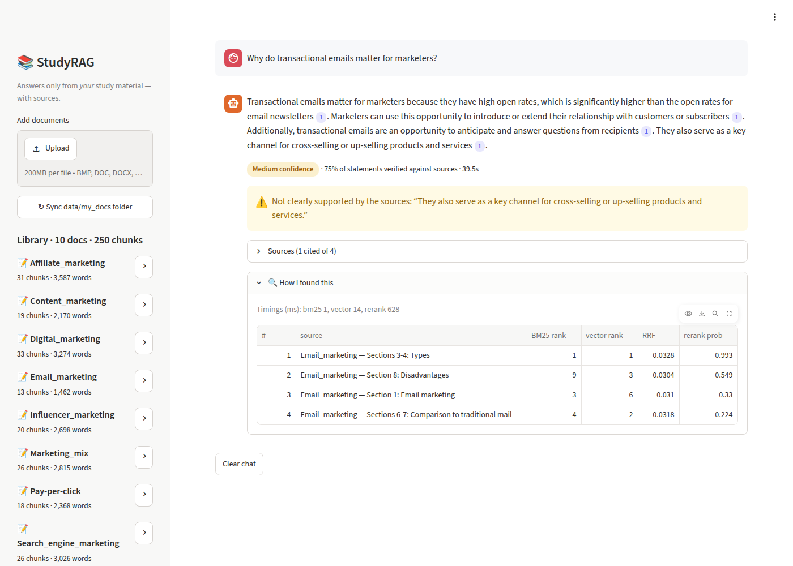

# StudyRAG

A private study assistant that answers **only from your own course material** (slides, PDFs, Word files, notes,
even image-only slides through OCR), with a citation to the exact slide or page, and says "not in your documents"
when the answer isn't there. Everything runs on a CPU; no GPU needed.



```bash
pip install studyrag                      # search, citations, OCR, CLI (models download on first use)
pip install "studyrag[local-llm]"         # + local LLM answers via llama.cpp (compiles; see the setup guide)

studyrag sync ~/my-lecture-notes          # index a folder (data lives in ~/.studyrag; STUDYRAG_HOME to change)
studyrag search "porter five forces"      # ranked, cited passages
studyrag ask "What is a market space?"    # needs a local model or an OpenAI-compatible API (STUDYRAG_LLM_BACKEND=openai)
```

Built from scratch: BM25, vector search, Reciprocal Rank Fusion, cross-encoder reranking, a calibrated refusal
threshold and a sentence-level answer verifier. Measured on 77 labelled questions: the right passage in the top 3
for 100% of answerable questions, 14/14 unanswerable questions refused.

- Use it from Claude Code, Claude Desktop or Cursor with the MCP server: [`studyrag-mcp`](https://pypi.org/project/studyrag-mcp/)
- Source, Streamlit web app, results and docs: [https://github.com/Abubakar-idrees-01/data-to-impact/tree/main/01-rag-from-scratch](https://github.com/Abubakar-idrees-01/data-to-impact/tree/main/01-rag-from-scratch)
