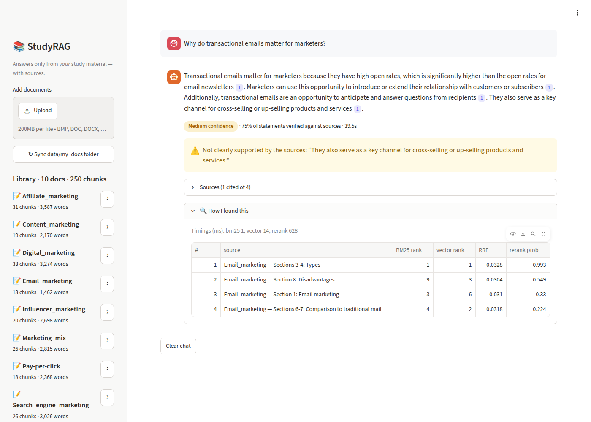
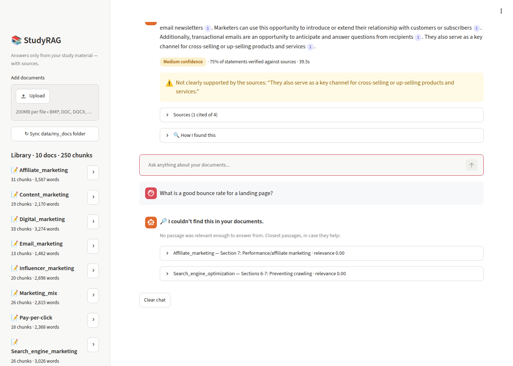
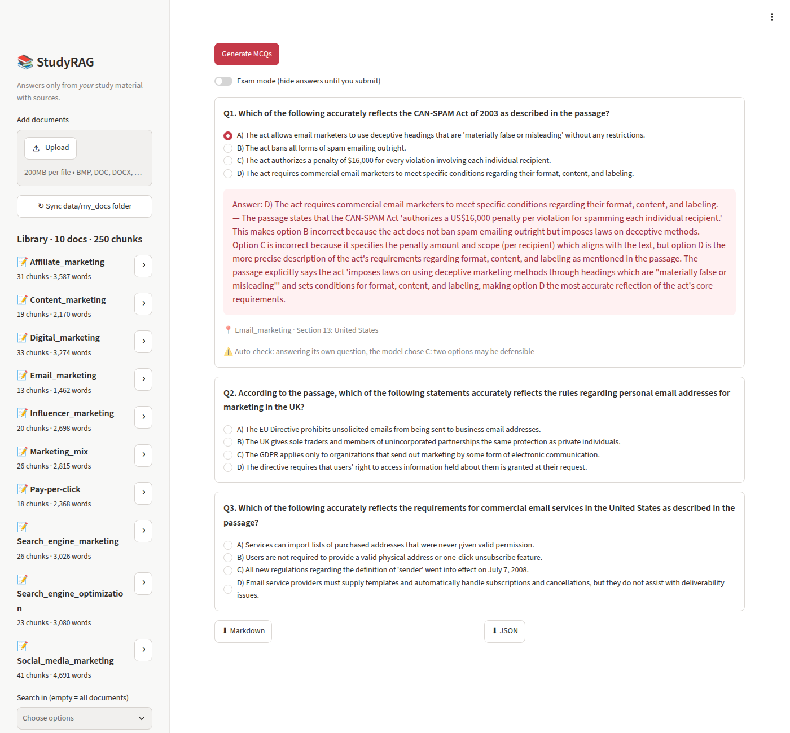
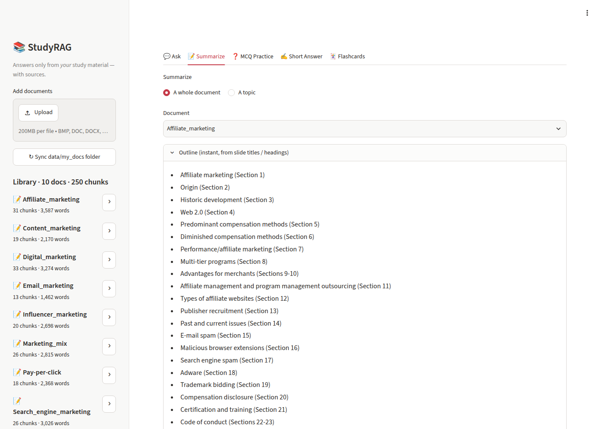

# 📚 StudyRAG: a private study assistant that only answers from *your* material

Upload your lecture slides, PDFs and notes. Ask questions, get **summaries**, and practise with
**MCQs, short-answer questions and flashcards**. Every answer cites the exact slide or page it came from,
and when the answer isn't in your material it says so instead of making something up.

Runs **fully offline on a 2015 laptop CPU** (no GPU, no API key), with an optional API backend for speed.

**Measured on a 2015 i5 laptop** (77 labelled questions, details in [docs/RESULTS.md](docs/RESULTS.md)):
the right passage is in the top 3 for **100%** of answerable questions; **14/14** unanswerable questions are refused;
**94%** of key facts are found on real OCR'd lecture slides; **98%** of the model's citations point to a passage
that supports the sentence; ~35 s per answer, fully offline.

## Screenshots
| Grounded answer with citations, verification and the retrieval trace | Honest refusal, with the closest passages offered |
|---|---|
|  |  |
| The verifier flags a sentence that overstates its source ("a key channel"; the source says "an opportunity"). | Off-topic question: refused before calling the LLM (0.7 s). |

| MCQ practice: the self-check flags a question with two defensible options | Instant outline from slide titles / headings |
|---|---|
|  |  |

Screenshots are captured automatically from the running app (`python scripts/screenshots.py`), using the
public Wikipedia sample corpus.

## Why this project exists
Students get course material as slide decks and PDFs, and general chatbots answer from the internet, not from
*their* syllabus. They confidently invent things and can't point to the slide an exam question will come from.
StudyRAG answers only from what your teacher actually gave you, and shows its sources.

The first real test exposed a problem that most "chat with your PDF" demos ignore: **all 150 slides of the
three test lectures were images**, with zero extractable text. So StudyRAG includes an OCR stage that reads
image-only slides, scanned PDFs and photos of notes.

## Features
| | |
|---|---|
| 💬 **Grounded Q&A** | Answers with clickable citations (`Lec 2 — Slide 14`) and a streaming response |
| 🛑 **Honest refusal** | "Not in your documents" when nothing relevant is found: decided *before* calling the LLM |
| ✅ **Claim verification** | Every answer sentence is checked against its cited source; weak claims are flagged |
| 🎯 **Confidence badge** | Combines retrieval relevance with the verified-sentence ratio |
| 📝 **Summaries** | Instant outline from slide titles + AI summary (map-reduce for long lectures) |
| ❓ **MCQ practice** | 4 options, explanation and source per question; each question is self-checked by the model before you see it; exam mode with score |
| ✍️ **Short answers** | Type an answer and the AI grades it against the model answer and source passage |
| 🃏 **Flashcards** | Exportable to Anki |
| 📷 **OCR** | Image-only slides, scanned PDFs, PNG/JPG photos (RapidOCR, cached) |
| 🔍 **How I found this** | Each answer's full retrieval trace: BM25 rank, vector rank, fusion score, reranker score |
| 📂 **Formats** | PDF, PPTX, DOCX, TXT, MD, images, plus legacy DOC/PPT via LibreOffice; tables are rewritten as sentences so search understands them |
| ⚡ **Incremental index** | Adding a file only processes that file; OCR results are cached |

## Built from scratch vs. off-the-shelf
| Built in this repo | Used off-the-shelf |
|---|---|
| Chunking (fixed / structure-aware / semantic) | File parsers (python-pptx, python-docx, pypdf) |
| BM25 with inverted index, tokenizer and stemmer | Embedding model (bge-small, via fastembed/ONNX) |
| Vector search (NumPy cosine) | Cross-encoder reranker (MiniLM, via fastembed) |
| Reciprocal Rank Fusion | LLM runtime (llama.cpp) + model (Qwen3.5-2B, 4-bit) |
| Prompting, citation parsing, refusal logic, confidence | OCR models (RapidOCR) |
| Claim verifier, MCQ validation, self-check and de-biasing | Web UI framework (Streamlit) |
| Persistent incremental index, OCR layout reconstruction | |
| Evaluation harness and labelled datasets | |

## How it works
```
files ─► load + OCR ─► chunk ─► BM25 index + vector index
question ─► BM25 top-10 ┐
            vector top-10 ┴► Reciprocal Rank Fusion ─► cross-encoder rerank ─► relevant? ──no──► "not in your documents"
                                                                                  │yes
                                         local LLM with numbered sources ◄────────┘
                                                      │
                                    answer + [citations] ─► verify each sentence ─► confidence
```
Full walkthrough: **[docs/HOW_IT_WORKS.md](docs/HOW_IT_WORKS.md)**

## Quickstart
```bash
cd 01-rag-from-scratch
python -m venv .venv && source .venv/bin/activate     # Windows: .venv\Scripts\activate
pip install -r requirements.txt                       # compiles llama.cpp: 5-15 min
pip install --no-deps -e .                            # the studyrag package + command
python scripts/download_models.py                     # ~1.5 GB, resumable
streamlit run app/streamlit_app.py
```
Put your files in `data/my_docs/` (never pushed to git) and click **Sync**. Full guide, Windows/macOS notes and
troubleshooting: **[docs/SETUP.md](docs/SETUP.md)**

## Results
| | public set (Wikipedia, 42 q) | private set (OCR'd lectures, 35 q) |
|---|---|---|
| retrieval hit@3 / MRR@10 | 1.00 / 0.971 | 1.00 / 0.966 |
| answerable questions answered | 34 / 34 | 28 / 29 ¹ |
| unanswerable questions refused | 8 / 8 | 6 / 6 |
| key-fact recall | 0.90 | 0.94 |
| answers mostly correct (≥ 50% of key facts) | 0.97 | 0.96 |
| faithfulness (sentences backed by sources) | 0.95 | 0.95 |
| citation support (cited passage backs the sentence) | 0.96 | 0.98 |
| median time per answer (Qwen3.5-2B, CPU) | 32 s | 35 s |

¹ A grading-table row the reranker scores low; the refusal still shows that passage ([why](docs/RESULTS.md#2-refusal-calibration)).

**Things the evaluation caught** (each fixed and re-measured, see [DECISIONS](docs/DECISIONS.md)):
an OCR model that turned 3.4% of slide lines into gibberish · tables the reranker couldn't read · MCQ explanations
pointing at the wrong letter after shuffling · MCQs with two defensible answers (now self-checked) · a 2× slower reranking depth with no accuracy gain.

**Model choice, measured:** Qwen3.5-0.8B answers in 15 s and Qwen2.5-1.5B in 23 s, but on real slides the default
Qwen3.5-2B's citations were the most reliable (0.98 vs 0.80 for the 1.5B). [Full comparison](docs/RESULTS.md#6-which-local-model-same-pipeline-three-models).
All numbers come from `eval/run_eval.py` and are explained in **[docs/RESULTS.md](docs/RESULTS.md)**. Design choices
backed by these measurements are in **[docs/DECISIONS.md](docs/DECISIONS.md)**.

## Read it as PDFs
Prefer documents to Markdown? Every guide is also a formatted PDF in [docs/pdf/](docs/pdf/):

| | |
|---|---|
| 📄 [**Overview**](docs/pdf/StudyRAG-Overview.pdf) | The project on one page (2 pages) |
| 🗓️ [**Timeline**](docs/pdf/StudyRAG-Timeline.pdf) | How it was built: each phase, the problems met and how they were solved |
| 🛠️ [**Setup Guide**](docs/pdf/StudyRAG-Setup-Guide.pdf) | Install and run on Linux, Windows or macOS |
| 🧭 [**How It Works**](docs/pdf/StudyRAG-How-It-Works.pdf) | Architecture, step by step |
| 📊 [**Results**](docs/pdf/StudyRAG-Results.pdf) · [**Design Decisions**](docs/pdf/StudyRAG-Design-Decisions.pdf) | Every measurement, and the choices they drove |
| 🎓 [**Concepts Handbook**](docs/pdf/StudyRAG-Concepts-Handbook.pdf) | All 11 concept notes in one book |

The Markdown files are the source; `python scripts/build_pdfs.py` regenerates the PDFs (needs pandoc and Chrome).

## Learn how it works
Concept notes, written to be understood and explained in an interview:

1. [Chunking](docs/concepts/01-chunking.md) · 2. [BM25](docs/concepts/02-bm25.md) · 3. [Embeddings & vector search](docs/concepts/03-embeddings-and-vector-search.md) ·
4. [Hybrid search & RRF](docs/concepts/04-hybrid-search-rrf.md) · 5. [Reranking](docs/concepts/05-reranking.md) ·
6. [Grounded generation](docs/concepts/06-grounded-generation.md) · 7. [Verification](docs/concepts/07-verification.md) ·
8. [OCR](docs/concepts/08-ocr.md) · 9. [Local LLMs on CPU](docs/concepts/09-local-llms.md) ·
10. [Question generation](docs/concepts/10-question-generation.md) · 11. [Evaluation](docs/concepts/11-evaluation.md)

## Project layout
```
src/studyrag/   the library (ingest, chunking, bm25, vector_index, hybrid, retrieval, llm, answer, verify, study)
app/            Streamlit web app
eval/           labelled datasets + evaluation harness
tests/          unit + pipeline tests (fake models, run in seconds)
scripts/        model download, sample corpus fetch
docs/           overview, timeline, setup, architecture, concepts, decisions, results (+ PDF editions in docs/pdf/)
```

## Limitations
- Small local models are slow on old CPUs (see the speed results) and weaker than large cloud models at nuanced
  questions; the API backend exists for that trade-off.
- The claim verifier is a fast heuristic (word overlap + semantic similarity), not logical entailment.
- Generated MCQs: in a strict human review, about 1 in 4 had a flaw (e.g. two defensible options). The self-check
  flags some of them; every question shows its source so you can check. A larger model via the API backend does better.
- One answerable question in 63 was refused (a table row the reranker scores low); the refusal shows that passage.
- OCR handles printed text well; handwriting and complex diagrams are out of scope.
- English only (embedding model, stemmer and stopwords).

## License
Code: MIT. Sample corpus: Wikipedia articles, CC BY-SA 4.0 (attribution in each file).
