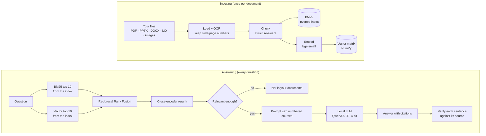
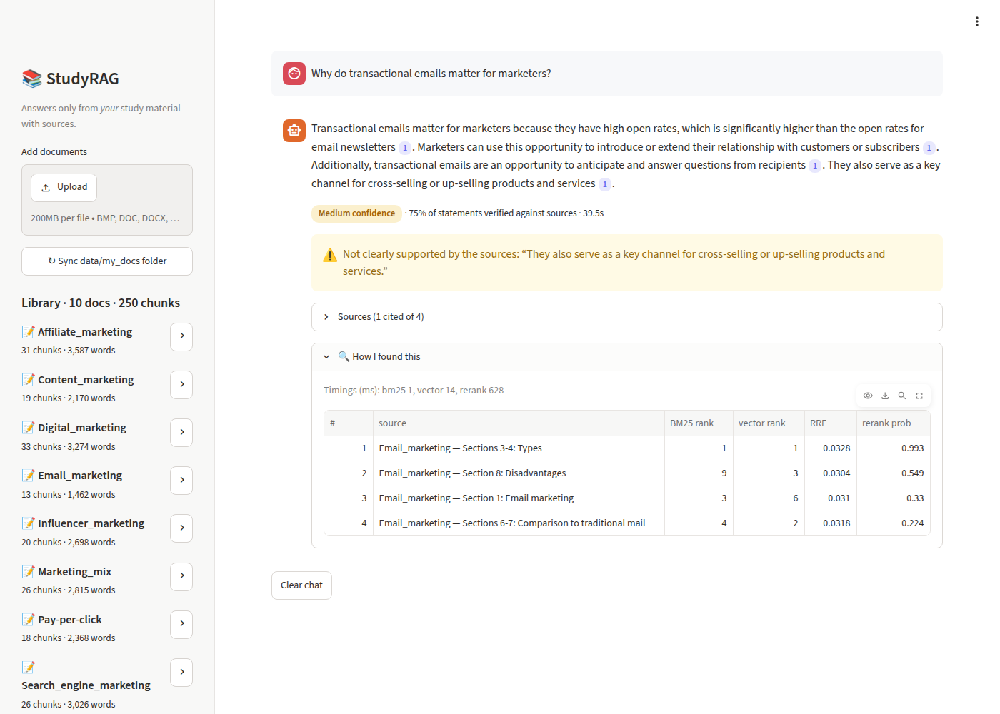

# How StudyRAG Works

This page follows one question through the whole system. Every step links to the code and to a
concept note that explains the idea from scratch.

## The big picture

RAG means **Retrieval-Augmented Generation**: instead of asking a language model to answer from its
memory (where it may invent things), we first **retrieve** the relevant passages from your documents
and then ask the model to answer **using only those passages**.



## Step by step

### 1. Loading documents → [`ingest/loaders.py`](../src/studyrag/ingest/loaders.py)
Each file becomes a list of **blocks**, the smallest unit with a citable location:

| File | Block = | Library |
|---|---|---|
| PPTX | one slide (title, text, tables, speaker notes) | python-pptx |
| PDF | one page | pypdf |
| DOCX | one heading-delimited section (with tables) | python-docx |
| MD / TXT | one heading section / whole file | built-in |
| PNG/JPG, image-only slides, scanned pages | OCR'd text | RapidOCR |

Text is then normalised ([`cleaning.py`](../src/studyrag/ingest/cleaning.py)): bullet styles unified, hyphenated
line breaks re-joined, whitespace collapsed. → [concept: OCR](concepts/08-ocr.md)

### 2. Chunking → [`chunking.py`](../src/studyrag/chunking.py)
Blocks are turned into **chunks** (retrieval units). The default *structure-aware* strategy keeps one slide or
section per chunk, splits oversized ones at paragraph/sentence boundaries, and merges thin neighbours such as
title-only slides. Every chunk carries a **contextual header** like `Digital Marketing Lec 1 — Slide 4: Online
Market space`, which is indexed together with the text. → [concept: chunking](concepts/01-chunking.md)

### 3. Indexing → [`library.py`](../src/studyrag/library.py)
- **BM25 index**: an inverted index from stemmed words to chunks. → [concept](concepts/02-bm25.md)
- **Vector matrix**: one 384-dimension embedding per chunk, L2-normalised. → [concept](concepts/03-embeddings-and-vector-search.md)
- Saved to `storage/` (`manifest.json`, `chunks.jsonl`, `embeddings.npy`). Adding a file only embeds *its* chunks
  (incremental indexing), and the OCR cache means no image is ever OCR'd twice.

### 4. Retrieval → [`retrieval.py`](../src/studyrag/retrieval.py)
1. BM25 returns its top 10 chunks; vector search returns its top 10 (`candidates`, see DECISIONS D13).
2. **Reciprocal Rank Fusion** merges the two lists using only ranks. → [concept](concepts/04-hybrid-search-rrf.md)
3. A **cross-encoder** re-scores the fused candidates by reading question and chunk together, and the top 4 are kept. → [concept](concepts/05-reranking.md)

Every step's ranks and scores are kept in a trace, which you can see in the app's **🔍 How I found this** panel.

### 5. Refusal check → [`answer.py`](../src/studyrag/answer.py)
If even the best chunk's reranker relevance is below a calibrated threshold, we answer
*"I couldn't find this in your documents"* **without calling the LLM at all**: an honest answer that is also fast.

### 6. Grounded generation → [`prompts.py`](../src/studyrag/prompts.py), [`llm/`](../src/studyrag/llm/)
The top chunks are numbered `[1]..[4]` in the prompt. The model is told to use only them, cite after every
sentence, and reply `NOT_FOUND` if they don't contain the answer. The model runs locally through llama.cpp,
4-bit quantized, with "thinking mode" disabled for speed. → [concept: grounded generation](concepts/06-grounded-generation.md),
[concept: local LLMs](concepts/09-local-llms.md)

### 7. Verification → [`verify.py`](../src/studyrag/verify.py)
Each answer sentence is scored against the passages it cites (word overlap plus semantic similarity). Unsupported
sentences are flagged in the UI, and the share of verified sentences feeds the **confidence badge**.
→ [concept](concepts/07-verification.md)

### 8. Study tools → [`study/`](../src/studyrag/study/)
MCQs, short-answer questions and flashcards are generated **one passage at a time** as constrained JSON, then
validated (4 distinct options, no "all of the above", answer supported by the passage), de-duplicated, and
shuffled to remove the model's habit of putting the answer at "A". Summaries use map-reduce for long documents.
→ [concept](concepts/10-question-generation.md)

### 9. Evaluation → [`eval/run_eval.py`](../eval/run_eval.py)
Retrieval quality, refusal calibration, verifier accuracy, answer correctness and MCQ quality are all measured.
→ [concept](concepts/11-evaluation.md) · [results](RESULTS.md)

## What it looks like
The answer below shows steps 4–7 in the app: numbered citations, the sentence the verifier flagged, and the
**🔍 How I found this** panel with each passage's BM25 rank, vector rank, fusion score and reranker score.



## Code map

```
src/studyrag/
├── config.py          all tunable settings (env-overridable)
├── ingest/            loaders.py · cleaning.py · ocr.py · models.py
├── chunking.py        fixed / structure / semantic chunkers, Chunk dataclass
├── text.py            tokenizer + stemmer for BM25
├── bm25.py            BM25 with inverted index            ← from scratch
├── vector_index.py    cosine search with NumPy           ← from scratch
├── hybrid.py          Reciprocal Rank Fusion             ← from scratch
├── embeddings.py      bi-encoder + cross-encoder wrappers (fastembed / ONNX)
├── library.py         persistent, incremental index
├── retrieval.py       the retrieval pipeline + trace
├── prompts.py         every prompt in one place
├── llm/               llama.cpp backend · OpenAI-compatible backend
├── answer.py          prepare → generate → finalize (citations, refusal, confidence)
├── verify.py          sentence-level grounding check
├── study/             generate.py (MCQ/short/flashcards) · summarize.py · quiz.py
├── core.py            StudyRAG: wires everything together
└── cli.py             command-line interface
```
