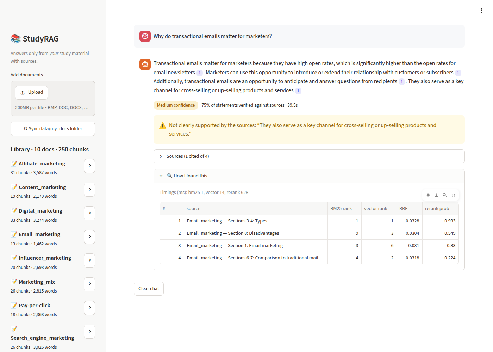

# StudyRAG in one page

**A private study assistant that answers only from your own course material, and shows where each answer came from.**

## The problem
Students get their material as slides and PDFs. General chatbots answer from the internet, not from *your*
syllabus. They sometimes invent things, and they can't point to the slide an exam question will come from.

## What StudyRAG does
- **Answers questions** from your slides, PDFs and notes, with a citation such as *Lec 2 — Slide 14* after each sentence.
- **Says "not in your documents"** when the answer isn't there, instead of guessing.
- **Checks itself:** every sentence is compared with its source, and weak claims are flagged.
- **Helps you revise:** summaries, MCQs (self-checked by the model), short-answer questions with grading, flashcards.
- **Reads image-only slides** with OCR, so slides exported as pictures still work.
- **Runs offline on an old laptop:** no GPU, no API key, and your files never leave your computer.

## How it works, in five steps
1. **Read** your files (with OCR for pictures) and split them into slide- or section-sized passages.
2. **Search** two ways at once: by keywords (BM25) and by meaning (embeddings), then merge the two rankings.
3. **Rerank** the best candidates with a model that reads question and passage together. If nothing is
   relevant enough, refuse.
4. **Answer** with a small local language model (Qwen3.5-2B) that may only use the numbered passages, and must cite them.
5. **Verify** each sentence against the passage it cites.

## Results (measured on a 2015 laptop CPU)
| | Public set (Wikipedia) | Your lectures (OCR'd slides) |
|---|---|---|
| Right passage in the top 3 | 100% | 100% |
| Unanswerable questions refused | 8 of 8 | 6 of 6 |
| Key facts found in the answer | 90% | 94% |
| Citations that back their sentence | 96% | 98% |
| Time per answer | ~32 s | ~35 s |

## Built with
Python · hand-written BM25, vector search and rank fusion · fastembed (ONNX) for embeddings and reranking ·
llama.cpp with a 4-bit Qwen3.5-2B · RapidOCR · Streamlit.

## Learn more
| Document (PDF) | What's in it |
|---|---|
| [Setup Guide](pdf/StudyRAG-Setup-Guide.pdf) | Install and run it on Linux, Windows or macOS |
| [How It Works](pdf/StudyRAG-How-It-Works.pdf) | The architecture, step by step |
| [Results](pdf/StudyRAG-Results.pdf) | Every measurement, with the method behind it |
| [Design Decisions](pdf/StudyRAG-Design-Decisions.pdf) | Why each choice was made, backed by measurements |
| [Timeline](pdf/StudyRAG-Timeline.pdf) | How the project was built, the problems met and how they were solved |
| [Concepts Handbook](pdf/StudyRAG-Concepts-Handbook.pdf) | One learning note per idea, written for interviews |

Code: <https://github.com/Abubakar-idrees-01/data-to-impact/tree/main/01-rag-from-scratch>
