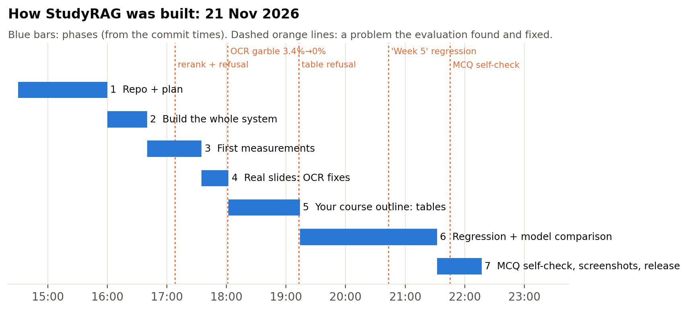
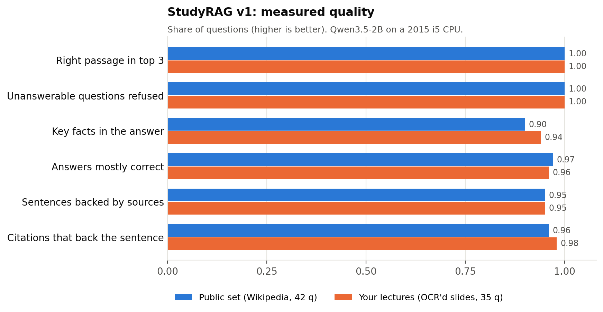
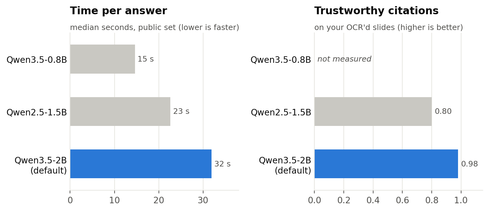
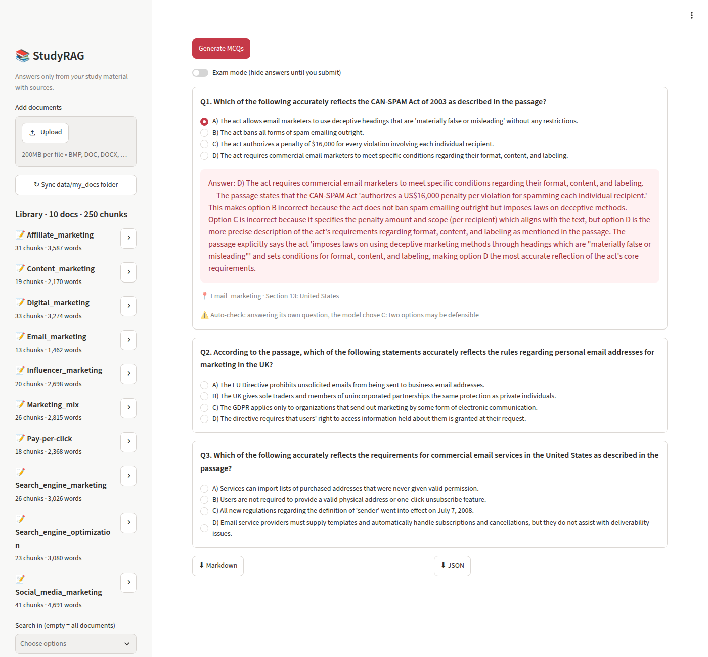

# StudyRAG: Project Timeline

How StudyRAG went from an empty folder to a measured, documented study assistant: what was built, in what
order, what went wrong, and how each problem was solved. Times come from the commit history (21 November 2026).

## Where we started
- **An empty folder** that was to become a portfolio of five AI projects, and one laptop to build them on: an Intel
  i5-5200U from 2015 with 2 cores, **no GPU**, 15 GB RAM, a slow internet connection (PyPI downloads at 30–80 KB/s)
  and only ~8 GB free on the system drive.
- **A goal:** a study assistant that answers *only* from your own course material, cites the slide or page, says
  "not in your documents" instead of guessing, and makes MCQs, short questions, flashcards and summaries.
- **Test material:** three real Digital Marketing lecture decks (150 slides) and a course outline.

## Where we ended
- A working app (Streamlit web UI and a command-line tool), fully offline on that 2015 laptop.
- **Measured on 77 labelled questions:** the right passage was in the top 3 for every answerable question, all
  14 unanswerable questions were refused, 94% of key facts were found on the real slides, and 98% of the model's
  citations backed their sentence. Each answer takes about 35 seconds.
- 28 unit tests, an evaluation harness, 21 recorded design decisions, 11 concept notes, screenshots, and these PDFs.

---

## Phase by phase

### Phase 1: Repository and plan (≈14:30–16:00)
**What we did:** created the `data-to-impact` repository, wrote the portfolio roadmap, scaffolded all five
projects with their own README and project context, and set a documentation standard. Then we chose the scope of
project 1: a *study assistant*, not a generic "chat with PDF".

| Difficulty | How we solved it |
|---|---|
| Pushing to GitHub failed (no credentials on the machine). | Installed the GitHub CLI and ran `gh auth login` and `gh auth setup-git`. |
| Commits showed "Claude" as a co-author next to your name. | Rewrote the history to remove the trailer, force-pushed safely (`--force-with-lease`), and made it a standing rule. |

### Phase 2: Build the whole system (16:00–16:40)
**What we did:** wrote the full pipeline as small, separate modules, each committed on its own:
document loaders (PDF, PPTX, DOCX, TXT, MD, legacy Office) → three chunking strategies → **BM25 written by hand**
→ **vector search in NumPy** → **Reciprocal Rank Fusion** → cross-encoder reranker → a persistent, incremental
index → local and API LLM backends → grounded answers with citations, refusal and sentence-level verification
→ study tools (MCQs, short answers, flashcards, summaries, quiz grading) → CLI, Streamlit app, tests, evaluation
harness, a public sample corpus of 10 Wikipedia articles with 42 labelled questions, and the first docs.

| Difficulty | How we solved it |
|---|---|
| PyPI was extremely slow; PyTorch alone is ~200 MB to download and ~1 GB installed. | Avoided PyTorch completely: embeddings and reranking run on ONNX Runtime (fastembed), ~15 MB. Models come from Hugging Face, which was fast. |
| No prebuilt `llama-cpp-python` wheel was reachable. | Compiled it from source with portable CPU flags (`GGML_NATIVE=OFF`, AVX2, FMA, F16C). The flags are in the setup guide. |
| **All 150 lecture slides were pictures.** Text extraction found zero words. | Added an OCR stage (RapidOCR, pip-only, CPU): it reads image-only slides, scanned PDFs and photos, rebuilds lines, paragraphs and slide titles, and caches results by image hash. 150 slides → 13,460 words. |
| The disk with the OS had little space. | Models and caches live in the project's `models/` folder on the large drive, never in the home folder. |

### Phase 3: First measurements (16:40–17:35)
**What we did:** ran the evaluation harness for the first time: retrieval (3 chunking strategies × 4 search
methods), refusal, verifier, LLM speed, and full end-to-end answers.

| Problem the measurements found | Fix | Effect |
|---|---|---|
| The verifier marked correct sentences as unsupported because of `**bold**` and bullet symbols. | Strip Markdown before scoring. | Fair scores. |
| Reranking 20 candidates took 2.1 s per question. | Rerank only the top 10. | **2× faster** (1.0 s), hit@1 even rose 0.91 → 0.94. |
| The refusal threshold (a guess, 0.02) let 1 of 8 unanswerable questions reach the model. | Calibrated on real scores: answerable ≥ 0.80, unanswerable ≤ 0.065 → threshold **0.2**. | 8/8 refused, 34/34 answered. |
| The model often dropped `[1]` citations in bullet lists. | Prompt rule "cite every bullet", plus automatic citation of sentences the verifier proves are supported. | Citation precision **0.71 → 0.86**. |
| Refusals showed "0.0 s". | The timer now starts before retrieval. | Honest timings. |
| Using 4 CPU threads was *slower* than 2. | Default to the number of physical cores. | 5.7 tok/s instead of 4.7. |

### Phase 4: Real slides, real problems (17:35–18:02)
**What we did:** built the private evaluation set: 35 questions about your own lectures (29 answerable,
6 unanswerable). It stays on your computer; only the averages are published.

| Problem | Fix | Effect |
|---|---|---|
| OCR turned some perfectly upright lines into gibberish ("Thi so s i s e innee"): its direction classifier was wrongly flipping lines upside down. Measured: **3.4% of lines garbled**, often the first line of a definition. | Disabled the classifier (slides are upright by nature). | **0.0% garbled**, OCR ~15% faster. |
| Every evaluation index would OCR the same 150 slides again (~12 min each). | One shared OCR cache for every index. | OCR runs once per image, ever. |

### Phase 5: Your course outline, and tables (18:02–19:14)
**What we did:** ran the private set end to end. Only **one** of 63 answerable questions was wrongly refused:
*"How much is the final examination worth?"*

| Problem | Fix | Effect |
|---|---|---|
| The answer was a row in the grading table. Search ranked it #1, but the reranker scored it 0.005: pipe-separated rows like `Final \| 40%` read as noise to a model trained on sentences. | Rewrite each table row as a sentence with its headers: "Final examination — Weight: 40%." | Relevance for "weightage of the final exam" **0.02 → 0.80**. |
| A wrong refusal was a dead end for the student. | A refusal now shows the two closest passages with their text. | A false refusal costs one click. |
| MCQ explanations said "Option C is correct" after shuffling had moved that option to D. Found by reading every generated question by hand. | Remap every letter reference with the shuffle order, strip options repeated inside the question, and ask the model to refer to options by content. | Every explanation matches the letters on screen. |
| Citation precision against our labels undercounts, because lectures repeat facts on several slides. | Added a second, label-free metric: *does the cited passage support the sentence?* | Citation support 0.96 (public) / 0.98 (private). |

### Phase 6: A regression, and choosing the model (19:14–21:32)
**What we did:** re-ran the evaluation after the table fix, compared three local models on the same pipeline,
and reviewed 30 generated MCQs by hand.

| Problem | Fix | Effect |
|---|---|---|
| **The table fix broke another question.** The re-run showed "Which topic is taught in week 5?" answered wrongly, because the row label "Week 5" had become just "5". | Bare numeric labels keep their header ("Week 5 — Topics: …"); multi-line cells become one line; "Total" is not prefixed (the rule requires a digit). | Fixed and re-measured before release. This is why we re-run the evaluation after every change. |
| Some MCQs had two options that said the same thing. | Reject questions whose options paraphrase each other (threshold calibrated on the 30 reviewed MCQs). | Fewer duplicate-option questions. |
| Which model? Qwen3.5-2B decoded **2.5× slower** than the older Qwen2.5-1.5B, more than its size explains. | Measured all three on both sets instead of assuming. | Kept 2B: on your slides its citations were trustworthy 98% of the time vs 80%. The faster models are documented options. |

### Phase 7: MCQ self-check, screenshots, release (21:32–22:17)
**What we did:** made the model check its own MCQs, did a strict human review of 15 questions, captured
screenshots automatically from the running app, and wrote the final README and results.

| Problem | Fix | Effect |
|---|---|---|
| About 1 in 5 MCQs had two defensible answers, and the explanation then contradicted itself. | **Self-check:** the model answers its own question like a student. If it disagrees with its key, the question is regenerated once, then shown with a ⚠️ warning. | In the earlier run, both questions it flagged were ones the human review had judged flawed. |
| Screenshots: Streamlit scrolls inside its own container, so full-page captures came out cut off or blank. | Scroll each element into view, wait for tables to render, and filter out hidden widgets. | Four clean screenshots, re-creatable with one command. |
| Source headers showed literal `**` symbols. | Use HTML bold tags in that component. | Clean display. |

---

## What is still imperfect (and documented)
- **MCQs are the weakest output:** in the strict review, 8 of 15 were good, 3 borderline, 4 flawed. Every question
  shows its source passage; a larger model through the API backend does better.
- **One false refusal in 63:** the "final exam worth" phrasing still scores below the threshold. Lowering the
  threshold would let unanswerable questions through, so we kept it; the refusal shows the right passage.
- **Speed:** ~35 s per answer on a 2015 CPU. The 0.8B model halves that.

## Lessons
1. **Test with real data.** The image-only slides, the OCR classifier bug and the table problem were all invisible
   on clean Wikipedia text.
2. **Measure, don't guess.** Two "obvious" settings (4 threads, 20 rerank candidates) were worse than the
   alternatives, and the newest model was the slowest.
3. **Re-run the evaluation after every fix.** The table fix caused a regression that only the re-run caught.
4. **Read the outputs yourself.** The MCQ letter bug passed every automatic metric.
5. **Be honest about limits.** A refusal that shows its evidence, and a warning on a doubtful question, are worth
   more than a confident wrong answer.

## What's next
1. **Your review of the private questions:** check the 35 private questions in `eval/datasets/private/my_docs_qa.jsonl`.
2. **Optional:** deploy a public demo on Hugging Face Spaces.
3. **Project 2, `02-llm-evals`:** turn this project's evaluation harness into a reusable tool for the whole portfolio.
