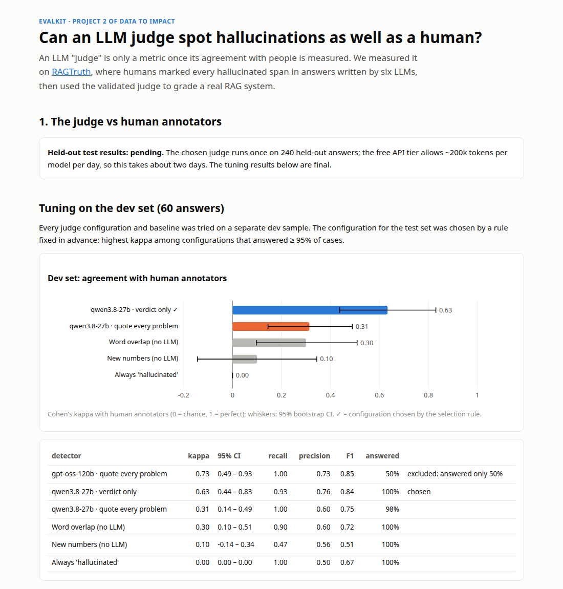

# 📏 evalkit: measure LLM systems, and measure the judge too

"Our RAG system is 90% faithful." According to what? Most LLM evaluations hand the grading to another LLM and
never check whether that judge agrees with people. **evalkit** is a small evaluation toolkit (Python standard
library only) that scores LLM outputs, compares versions with real significance tests, fails CI on regressions,
and **validates its LLM judge against human labels** before trusting it.

It is the shared evaluation layer of this portfolio: [StudyRAG](../01-rag-from-scratch) (project 1) is its first user.



*The report page ([`site/index.html`](site/index.html)) is self-contained: open it in any browser.*

## What it does
| | |
|---|---|
| 📐 **Metrics** | Exact match, token F1, ROUGE-L, key-fact recall; hit@k, MRR, nDCG; agreement (precision, recall, F1, Cohen's kappa, MCC) |
| 📊 **Honest numbers** | Every metric with a 95% interval (Wilson or bootstrap), because one question moves a 40-question score by 2.5 points |
| ⚖️ **Version comparison** | `evalkit compare v1.json v2.json`: paired tests (McNemar, paired bootstrap) and the exact items that got better or worse |
| 🚦 **CI gate** | `evalkit gate`: TOML rules (floors, max drop vs baseline, optional significance); exit code 1 fails the build |
| 🧑‍⚖️ **LLM judge** | Faithfulness and correctness rubrics with quoted evidence; any OpenAI-compatible API; disk cache; waits out rate limits |
| ✅ **Judge validation** | Agreement with human hallucination labels (RAGTruth) on a held-out set, against non-LLM baselines, with a selection rule fixed in advance |
| 📄 **Report** | One HTML file, inline SVG charts with confidence intervals, light/dark, no JavaScript |

## Results so far
**Tuning (dev set, 60 human-labelled answers):** kappa with human annotators

| detector | kappa (95% CI) |
|---|---|
| **Qwen3.8-27B, verdict-only rubric** | **0.63** (0.44 – 0.83) |
| Qwen3.8-27B, "quote every problem" rubric | 0.31 (0.15 – 0.49) |
| Word overlap (no LLM) | 0.30 (0.10 – 0.51) |
| Always "hallucinated" | 0.00, although its F1 is 0.67 |

**Held-out test (240 answers) and StudyRAG grading:** running on the free API tier, results pending
([status](docs/RESULTS.md)).

**StudyRAG v1 → v2 (paired, 34 questions):** citation precision +0.16 is real (p = 0.008); the key-fact change
(−0.015, p = 0.74) is noise.

**Things the evaluation caught in the evaluator** (see [DECISIONS](docs/DECISIONS.md)):
- **The evidence rubric made a judge a nitpicker:** asking it to list problems got wording like "tasty" for "liked" flagged as hallucinations.
- **A judge that fails half the time topped the table:** a reasoning model returned empty replies for half the cases, and its kappa looked best on the half it answered.
- **F1 rewards a detector that always says "hallucinated":** F1 0.67, kappa 0.

## Quickstart
```bash
cd 02-llm-evals
python3 -m venv .venv && source .venv/bin/activate
pip install -r requirements-dev.txt && python -m pytest -q       # no network needed
export PYTHONPATH=src
python -m evalkit compare results/studyrag-answers/v1.json results/studyrag-answers/v2.json
```
Use it from another project with `pip install -e ../02-llm-evals` (adds no dependencies), or write per-item JSONL and
run `evalkit import`. The LLM judge needs an API key in `.env`. Full guide: **[docs/SETUP.md](docs/SETUP.md)**.

## Documentation
| | |
|---|---|
| [How it works](docs/HOW_IT_WORKS.md) | Architecture, data flow, code map |
| [Results](docs/RESULTS.md) | Every number, with intervals and caveats |
| [Design decisions](docs/DECISIONS.md) | Why each choice, backed by measurements |
| Concepts | 1. [Answer & retrieval metrics](docs/concepts/01-answer-and-retrieval-metrics.md) · 2. [Agreement & kappa](docs/concepts/02-agreement-and-kappa.md) · 3. [Confidence & significance](docs/concepts/03-confidence-and-significance.md) · 4. [Runs & regression gates](docs/concepts/04-runs-and-regression-gates.md) · 5. [LLM-as-judge](docs/concepts/05-llm-as-judge.md) · 6. [Validating a judge](docs/concepts/06-validating-a-judge.md) |

## Project layout
```
src/evalkit/   the library: dataset, metrics/, runs, compare, gate, llm, judge, baselines, report, cli
experiments/   RAGTruth sampling, judge validation, judge selection, StudyRAG grading, report, pipeline.sh
datasets/      committed sample ids (RAGTruth raw files are downloaded, never committed)
results/       committed runs with per-item results
gates/         CI quality rules
site/          the generated report
docs/          setup, architecture, concepts, decisions, results
```

## Limitations
- The judge is validated on RAGTruth's tasks and definitions (QA over web passages, news summaries, business
  descriptions). Agreement on other domains, such as lecture slides, is assumed, not measured.
- Balanced samples make precision look better than it would at a natural hallucination rate; kappa and recall are
  the headline metrics for that reason.
- Human labels are a single annotation per answer; inter-annotator agreement (the ceiling for any judge) is not
  measured here.
- Free-tier API limits make a full validation take about two days; with a paid tier it takes about an hour.

## License
Code: MIT. RAGTruth: MIT (Niu et al., 2024), downloaded at setup time.
