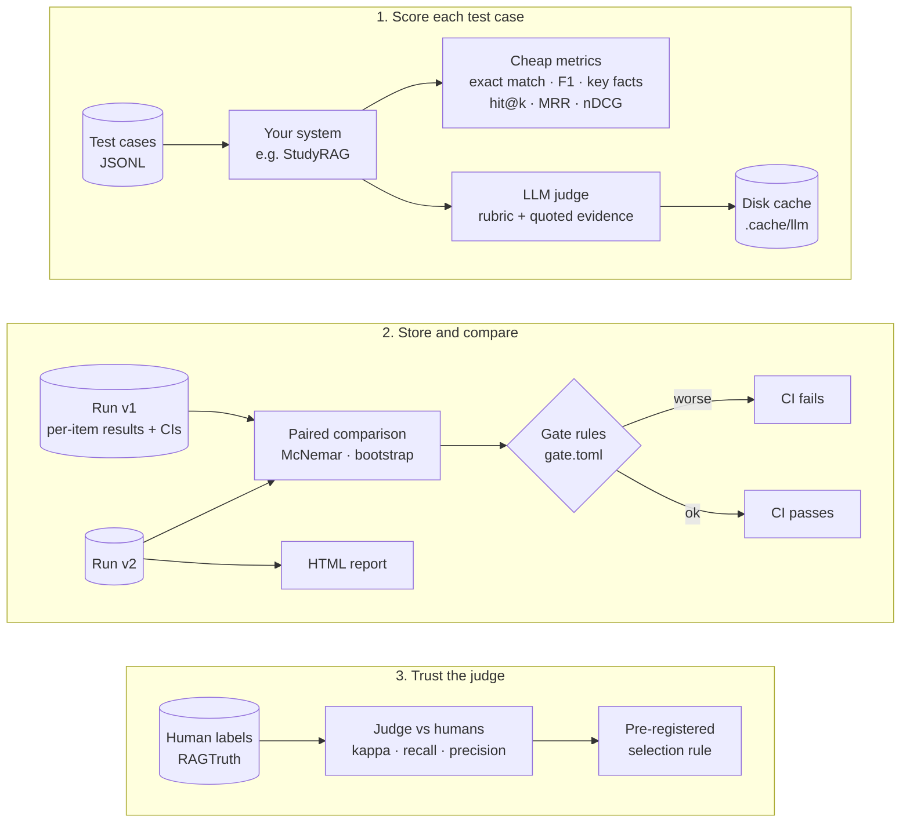

# How evalkit Works

evalkit answers one question for any AI system: **is it good, and is the new version really better?** It does
that with three layers: metrics that score single outputs, runs that store a whole evaluation, and comparisons
and gates that decide whether a change is an improvement or a regression. The LLM judge is one metric among
others, and it gets validated against humans before it is trusted.

## The big picture



## Step by step

### 1. Test cases → [`dataset.py`](../src/evalkit/dataset.py)
One JSON object per line: `id`, `input` and any of `expected`, `key_facts`, `context`, `gold`, `answerable`,
`tags`. Common field names from other projects (`question`, `answer`, `passages`) are accepted as aliases, so
StudyRAG's existing dataset loads unchanged.

### 2. Metrics → [`metrics/`](../src/evalkit/metrics/)
Pure functions, no dependencies, each checked against hand-computed values in the tests.
- `text.py`: exact match, token F1, ROUGE-L, key-fact recall → [concept](concepts/01-answer-and-retrieval-metrics.md)
- `retrieval.py`: hit@k, MRR, precision/recall@k, nDCG@k → [concept](concepts/01-answer-and-retrieval-metrics.md)
- `agreement.py`: confusion matrix, precision/recall/F1, balanced accuracy, Cohen's kappa, MCC → [concept](concepts/02-agreement-and-kappa.md)
- `stats.py`: Wilson and bootstrap intervals, paired bootstrap, McNemar, correlations → [concept](concepts/03-confidence-and-significance.md)

### 3. The LLM judge → [`llm.py`](../src/evalkit/llm.py), [`judge.py`](../src/evalkit/judge.py)
- `ChatClient` speaks the OpenAI-compatible protocol with only `urllib`. Every response is **cached on disk**,
  keyed by a hash of the whole request, so re-running an experiment is free and gives identical results.
  Rate limits (HTTP 429) are waited out using the provider's own "try again in…" hint. For long, unattended runs
  on a free tier, it waits for the daily quota to refill instead of failing.
- `Judge` = client + rubric. Rubrics ask for JSON; the faithfulness rubrics make the judge **quote the exact
  words** it objects to before giving a verdict, so every decision can be audited.
- Reasoning models (e.g. gpt-oss) get a larger output budget and `reasoning_effort`; a reply that came back
  empty because the budget ran out raises a clear error instead of being parsed as "no problems".
→ [concept: LLM-as-judge](concepts/05-llm-as-judge.md)

### 4. Runs → [`runs.py`](../src/evalkit/runs.py)
A run is one JSON file, `results/<suite>/<name>.json`: per-item results, aggregate metrics with 95% intervals,
the configuration, and the environment (git commit, uncommitted-changes flag, Python, CPU count). Any project can
create one without importing evalkit: `evalkit import details.jsonl --suite S --name v2`.

### 5. Comparing and gating → [`compare.py`](../src/evalkit/compare.py), [`gate.py`](../src/evalkit/gate.py)
`evalkit compare v1.json v2.json` pairs items by id and reports, for each metric, the change, its 95% interval,
a p-value, and the ids that got better or worse. `evalkit gate run.json --rules gate.toml --baseline v1.json`
exits with code 1 when a rule fails, which fails the CI job. → [concept](concepts/04-runs-and-regression-gates.md)

### 6. Validating the judge → [`experiments/`](../experiments/)
- `ragtruth.py` builds a balanced, seeded sample from RAGTruth: 60 **dev** cases (from RAGTruth's train split)
  for trying prompts and models, 240 **test** cases (from its test split) kept untouched until the end.
- `judge_validation.py` runs a judge configuration or the non-LLM baselines and saves agreement metrics.
- `select_judge.py` applies a selection rule written down before the results were in.
- `pipeline.sh` runs everything unattended; `studyrag_eval.py` then grades project 1 with the chosen judge.
→ [concept: validating a judge](concepts/06-validating-a-judge.md)

### 7. Report → [`report.py`](../src/evalkit/report.py), [`experiments/build_report.py`](../experiments/build_report.py)
One self-contained HTML file with hand-written SVG charts (every bar with its confidence interval and its value
printed), light and dark themes, no JavaScript. It's the project's live demo.

## Code map
```
src/evalkit/
├── dataset.py        test-case format (JSONL), aliases, validation
├── metrics/
│   ├── text.py       exact match, token F1, ROUGE-L, key-fact recall
│   ├── retrieval.py  hit@k, MRR, precision/recall@k, nDCG
│   ├── agreement.py  confusion matrix, F1, balanced accuracy, kappa, MCC
│   └── stats.py      Wilson / bootstrap CIs, paired bootstrap, McNemar, correlations
├── runs.py           Run: per-item results + CIs + config + environment, saved as JSON
├── compare.py        paired comparison of two runs (direction-aware)
├── gate.py           TOML rules -> pass/fail for CI
├── llm.py            OpenAI-compatible client: cache, retries, rate limits, accounting
├── judge.py          rubrics (faithfulness x3, correctness) and the Judge
├── baselines.py      non-LLM hallucination detectors
├── report.py         HTML building blocks and SVG charts
└── cli.py            evalkit import | summary | compare | gate
experiments/          RAGTruth sampling, judge validation, selection, StudyRAG grading, report, pipeline
gates/                quality rules used in CI
results/              committed runs (per-item, no source texts)
```
