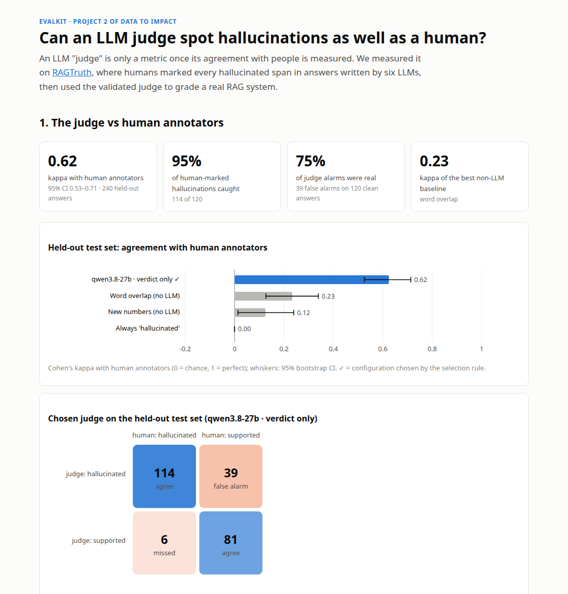

# evalkit in one page

**A small toolkit that measures LLM systems honestly, including the LLM that does the grading.**

## The problem
Teams ship prompt and model changes based on numbers like "faithfulness 0.91". Usually that number comes from
another LLM acting as a judge, on a few dozen questions, with no error bar and no check that the judge agrees
with people. A version can look better and be no better, or worse.

## What evalkit does
- **Scores outputs** with cheap exact metrics (F1, key facts, retrieval hit@k and MRR) and an **LLM judge** for
  what words can't capture (is every sentence backed by the source?).
- **Adds error bars** to every number and uses **paired tests** to say whether version B really beats version A.
- **Guards quality in CI:** rules like "never below 0.8, never significantly worse than last release" fail the build.
- **Validates the judge** against **human labels** (RAGTruth) on data it was never tuned on, against simpler
  baselines, with the choice of judge fixed in advance.
- **Produces a report:** one HTML page with charts, hostable anywhere.

## How it works, in four steps
1. **Test cases** in a simple JSONL format.
2. **Run** the system and score each case; save the run with its per-case results.
3. **Compare and gate:** pair cases between versions, test significance, apply the rules.
4. **Trust, but verify:** measure the judge's agreement with humans before using its scores.

## Results
| | |
|---|---|
| Judge vs humans, 240 held-out answers | kappa **0.625** (CI 0.53–0.71); catches 95% of hallucinations, 75% of alarms real |
| Best non-LLM baseline | kappa 0.233 |
| StudyRAG v1 → v2 | citation gain and speed-up real; correctness and faithfulness within noise |
| Cost | 715 API calls, ~807k tokens, $0 (free tier) |

## Built with
Python standard library only (statistics, HTTP, caching, SVG charts by hand) · Groq API (free tier) for the
judge · RAGTruth human labels · GitHub Actions for CI.

## Learn more
| Document (PDF) | What's in it |
|---|---|
| [Setup Guide](pdf/evalkit-Setup-Guide.pdf) | Install, configure the judge, reproduce the study |
| [How It Works](pdf/evalkit-How-It-Works.pdf) | Architecture, step by step |
| [Results](pdf/evalkit-Results.pdf) | Every number with its interval |
| [Design Decisions](pdf/evalkit-Design-Decisions.pdf) | Why each choice, backed by measurements |
| [Timeline](pdf/evalkit-Timeline.pdf) | How it was built, the problems met and how they were solved |
| [Concepts Handbook](pdf/evalkit-Concepts-Handbook.pdf) | Six learning notes, written for interviews |

Code: <https://github.com/Abubakar-idrees-01/data-to-impact/tree/main/02-llm-evals>
