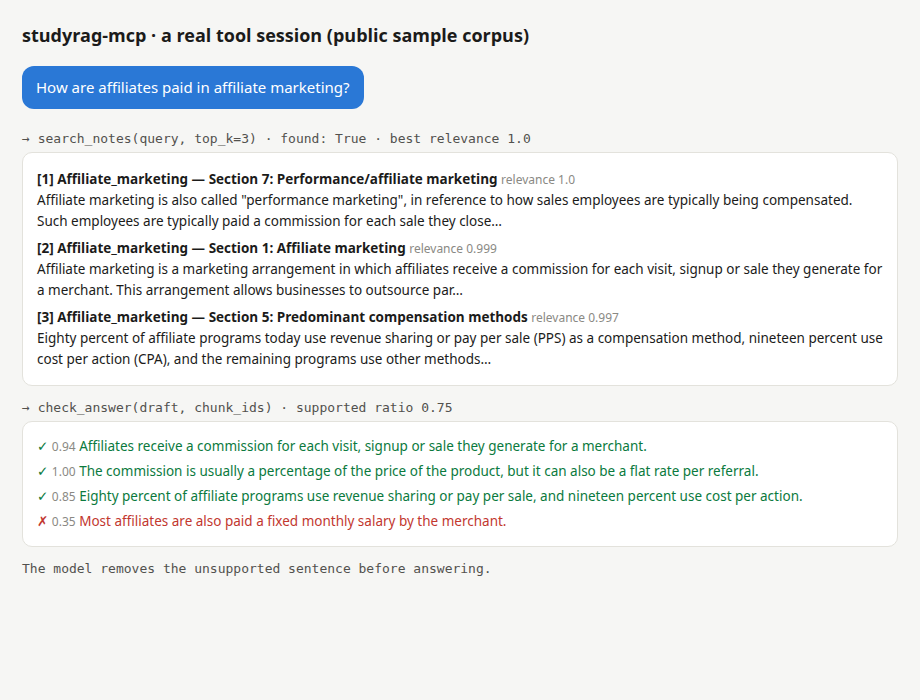

# studyrag-mcp

An **MCP server** that lets Claude Code, Claude Desktop, Cursor or any MCP client search your own study notes
(indexed by [StudyRAG](https://pypi.org/project/studyrag/)), read them slide by slide, and **fact-check answers
against them**, with citations. Read-only, local, no API key.



```bash
pip install studyrag-mcp
studyrag sync ~/my-lecture-notes          # index your notes once (StudyRAG's CLI, installed alongside)
```

Then add it to your assistant. For Claude Code, put this in `.mcp.json` at your workspace root:
```json
{"mcpServers": {"studyrag": {"type": "stdio", "command": "studyrag-mcp"}}}
```
(Use the full path to `studyrag-mcp` if it isn't on the PATH the assistant sees.)

**Tools:** `search_notes` (hybrid search with citations and an honest "not found"), `get_passage`,
`list_documents`, `document_outline`, `check_answer` (scores each sentence against the passages it cites),
plus evaluation-run tools when [evalkit](https://github.com/Abubakar-idrees-01/data-to-impact/tree/main/02-llm-evals) is installed. Prompts: *explain from my notes*,
*quiz me*, *revise a lecture*.

Docs, design notes and the from-scratch MCP implementation: [https://github.com/Abubakar-idrees-01/data-to-impact/tree/main/03-mcp-server](https://github.com/Abubakar-idrees-01/data-to-impact/tree/main/03-mcp-server)
