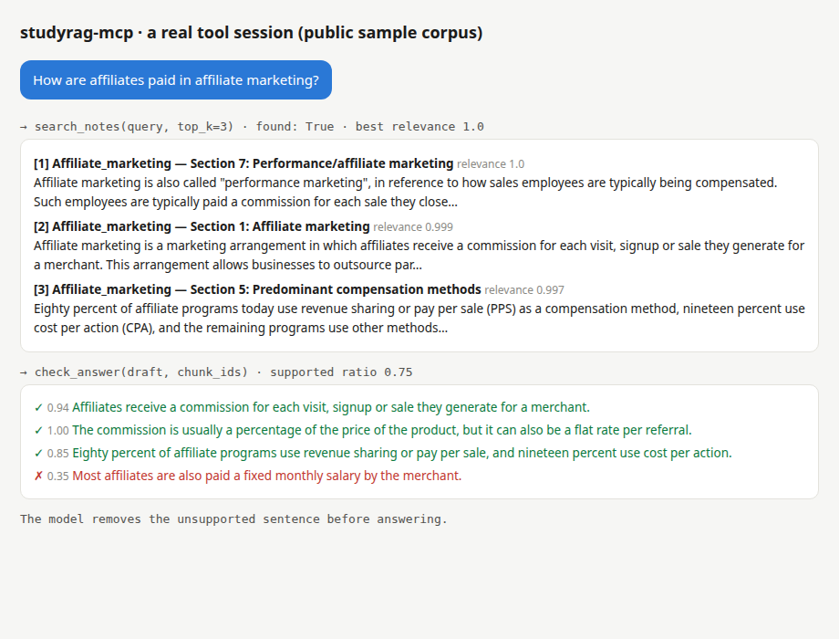

# 🔌 studyrag-mcp: your study notes as tools for any AI assistant

[](https://pypi.org/project/studyrag-mcp/) [](https://github.com/Abubakar-idrees-01/data-to-impact/actions/workflows/mcp-server.yml)

An **MCP server** that lets Claude Code, Claude Desktop, Cursor or any MCP client search your own lecture slides
and notes, read them slide by slide, and **fact-check answers against them**, with citations. It also gives the
assistant read access to your evaluation results. It runs locally on a CPU, needs no API key, and only reads.

It connects two other projects in this portfolio: [StudyRAG](../01-rag-from-scratch) (project 1) provides the search, and
[evalkit](../02-llm-evals) (project 2) provides the evaluation runs.



*A real session, on the public sample corpus. The assistant searches, drafts an answer, and checks it. The invented
last sentence (added on purpose) is caught and removed. Full transcript: [docs/DEMO.md](docs/DEMO.md).*
**PDFs:** [Overview](docs/pdf/studyrag-mcp-Overview.pdf) · [Timeline](docs/pdf/studyrag-mcp-Timeline.pdf) · [Setup](docs/pdf/studyrag-mcp-Setup-Guide.pdf) · [How it works](docs/pdf/studyrag-mcp-How-It-Works.pdf) · [Results](docs/pdf/studyrag-mcp-Results.pdf) · [Decisions](docs/pdf/studyrag-mcp-Design-Decisions.pdf) · [Concepts](docs/pdf/studyrag-mcp-Concepts-Handbook.pdf)

## Tools
| | tool | what it does |
|---|---|---|
| 🔎 | `search_notes` | Hybrid search (BM25 + embeddings + reranker) over your notes; numbered passages with citations, and `found: false` when nothing is relevant enough |
| 📄 | `get_passage` · `list_documents` · `document_outline` | Read a slide/page, list your library, outline a lecture |
| ✅ | `check_answer` | Scores each sentence of an answer against the passages it cites and lists unsupported ones |
| 📊 | `list_eval_runs` · `eval_run_summary` · `compare_eval_runs` | Read evalkit runs; "is v2 really better?" with paired significance tests |

Also **resources** (`notes://documents`, `notes://documents/{name}` for a whole lecture's text) and **prompts**
(*explain from my notes*, *quiz me*, *revise a lecture*).

## Highlights
- **Built twice:** on the official MCP SDK for real use, and **from scratch** (JSON-RPC over stdio in ≈ 250 lines of
  standard library). The official client connecting to the scratch version is a conformance test.
- **The server does no generation:** the assistant is the model. The server adds private search and claim checking.
- **Safe to call:** every tool is read-only, inputs are bounded, file access is confined (path traversal is refused
  and tested), and expected errors tell the model how to fix its call.
- **Measured:** 16 tests, including the installed server over real stdio with real models. Search takes 0.94 s;
  the first call takes 14 s to load models ([results](docs/RESULTS.md)).
- **Never stale:** when you sync new files in StudyRAG, the next tool call sees them.

## Quickstart
From PyPI (no clone needed):
```bash
python3 -m venv ~/.venvs/studyrag && source ~/.venvs/studyrag/bin/activate
pip install studyrag-mcp                 # also installs studyrag (project 1's search)
studyrag sync ~/my-notes                 # index a folder; downloads the 150 MB search models once
```
Then add it to your assistant: for Claude Code, put this in `.mcp.json` at your workspace root and reload.
```json
{"mcpServers": {"studyrag": {"type": "stdio", "command": "/HOME/YOU/.venvs/studyrag/bin/studyrag-mcp"}}}
```
The index lives in `~/.studyrag` (set `STUDYRAG_HOME` to move it). Working from a clone of this repo instead,
with project 1's index: [docs/SETUP.md](docs/SETUP.md), which also covers Claude Desktop and HTTP.

## Documentation
| | |
|---|---|
| [How it works](docs/HOW_IT_WORKS.md) | Architecture and one question end to end |
| [Results](docs/RESULTS.md) | Tests, latency, behaviour on real notes, problems found |
| [Design decisions](docs/DECISIONS.md) | Why each choice |
| Concepts | 1. [What MCP is](docs/concepts/01-what-is-mcp.md) · 2. [MCP on the wire](docs/concepts/02-mcp-on-the-wire.md) · 3. [Designing tools for an LLM](docs/concepts/03-designing-tools-for-an-llm.md) · 4. [Security and privacy](docs/concepts/04-security-and-privacy.md) |

## Privacy
The server runs locally and makes no network calls. Passages it returns are shown to your assistant, which means
they're sent to that assistant's provider, like text you paste into a chat.

## Layout
```
src/studyrag_mcp/  server.py (official SDK) · notes.py · evals.py · scratch.py (protocol from scratch)
tests/             scratch protocol + conformance, server in-process, stdio end to end
scripts/           benchmark.py
examples/          client config template
docs/              setup, architecture, concepts, decisions, results
```

## License
MIT.
