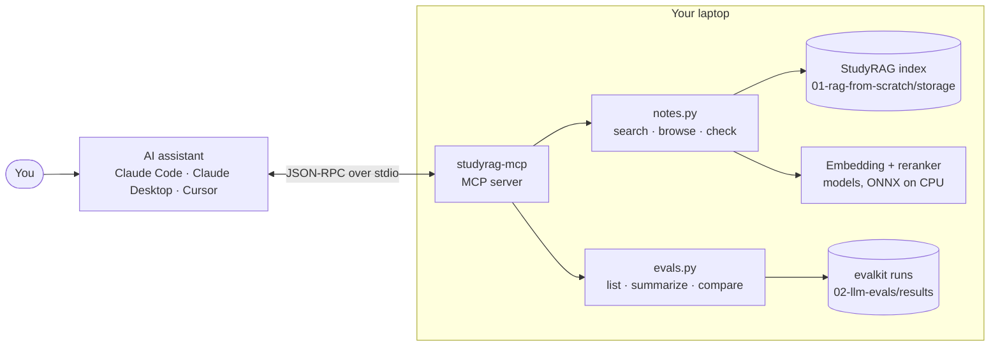

# How the StudyRAG MCP Server Works

The server sits between an AI assistant and two local things: your StudyRAG index (project 1) and your evalkit
results (project 2). It never generates text itself: it searches, reads, checks and reports, and the assistant
writes.

## The big picture

## A question, end to end
You ask Claude Code: *"Using my notes, what is a market space? Cite the slides."*
1. **Startup (once):** Claude Code read `.mcp.json`, launched `python -m studyrag_mcp`, and did the handshake
   (`initialize`, then `tools/list`). The model now sees 8 tools with their descriptions and schemas, plus the
   server's instructions.
2. **The model calls** `search_notes({"query": "market space definition", "top_k": 4})`.
3. **The server** (`notes.py`) loads StudyRAG on the first call (≈ 14 s, once) and runs project 1's retrieval:
   BM25 + vector search, Reciprocal Rank Fusion, cross-encoder reranking (≈ 1 s).
4. **It returns** numbered passages with citations, relevance and `chunk_id`s, plus `found: true/false` against
   the calibrated threshold and a guidance line.
5. **The model writes** the answer from those passages with `[n]` citations, and may call
   `check_answer(answer, chunk_ids)`. The server scores every sentence against its cited passage and lists
   unsupported ones; the model fixes them.
6. **You see** a cited answer from your own slides, or "your notes don't cover this".

## Components
| file | role |
|---|---|
| [`server.py`](../src/studyrag_mcp/server.py) | The MCP layer (official SDK `MCPServer`): 8 tools, 2 resources, 3 prompts, instructions, read-only annotations, error mapping, stdio / HTTP entry point |
| [`notes.py`](../src/studyrag_mcp/notes.py) | Plain-Python service over StudyRAG: search, list, outline, get passage, check answer, full text. Lazy loading; reloads the index when the app or CLI syncs |
| [`evals.py`](../src/studyrag_mcp/evals.py) | Read-only evalkit access with path confinement |
| [`scratch.py`](../src/studyrag_mcp/scratch.py) | MCP from scratch (JSON-RPC over stdio), for learning; conformance-tested with the official client |

## Design rules
- **The server does no generation.** The assistant is the model; the server adds what it can't do: access to private
  files and claim checking. → [concept](concepts/03-designing-tools-for-an-llm.md)
- **The MCP layer is thin.** All logic lives in `notes.py` / `evals.py`, testable without any protocol.
- **It's always safe to call.** Read-only, bounded inputs, confined paths, clear errors. → [concept](concepts/04-security-and-privacy.md)
- **It never goes stale.** When the StudyRAG app or CLI syncs new files, the next tool call reloads the index
  (the models stay loaded).

## Tests ([`tests/`](../tests/))
| file | what it proves |
|---|---|
| `test_scratch.py` | The from-scratch server speaks correct JSON-RPC/MCP; the official SDK client works with it over a real subprocess |
| `test_server.py` | Every tool, resource and prompt through the official client, in-process, with fake models (fast) |
| `test_stdio_e2e.py` | The installed server, launched exactly like Claude Code launches it, with the real models on the public sample index |
