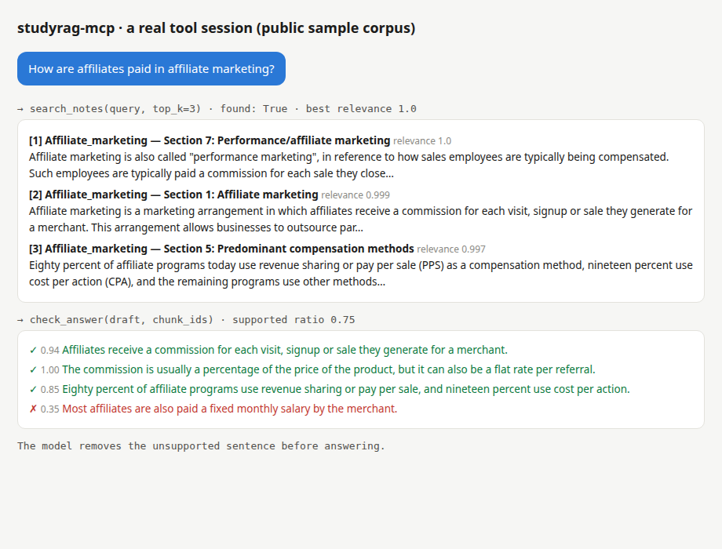

# studyrag-mcp in one page

**Your own study notes as tools for any AI assistant: search them, read them, and fact-check answers against them.**

## The problem
AI assistants know the internet, not your syllabus. Pasting slides into a chat is slow, fills the context, and the
assistant still can't tell you which slide a fact came from. Every app also needs its own plugin.

## What it is
An **MCP server**. MCP (Model Context Protocol) is the open standard that lets one tool server plug into many
assistants: Claude Code, Claude Desktop, Cursor and others. This server connects them to:
- **StudyRAG** (project 1): your lecture slides, PDFs and notes, already indexed with OCR and hybrid search;
- **evalkit** (project 2): your evaluation results.

## What the assistant can do with it
| | |
|---|---|
| Search your notes | Cited passages ("Lec 1 — Slide 4"), and an honest "not found" when your notes don't cover it |
| Read | A whole slide or page, a lecture's outline, your list of documents |
| Fact-check | Every sentence of its answer against the slides it cites; unsupported sentences are flagged |
| Study | Ready-made prompts: explain from my notes, quiz me, revise a lecture |
| Evaluate | Read evalkit runs and test whether version 2 really beats version 1 |

## How it works
The assistant launches the server on your laptop and talks to it over MCP (JSON-RPC over stdio). The server
searches and checks; the assistant writes. No API key, nothing leaves your laptop except passages the assistant
asks for.

## Results
| | |
|---|---|
| Search latency | 0.94 s (first call 14 s: loads the models once) |
| Tests | 15, including the real server over stdio with real models |
| Real use | Found the right slides in the owner's lectures; caught an invented sentence; refused an off-topic question |

## Built with
Python · official MCP SDK 2.3 · MCP implemented again from scratch (standard library) · StudyRAG's retrieval
(BM25 + embeddings + reranker, ONNX on CPU) · evalkit.

## Learn more
| Document (PDF) | What's in it |
|---|---|
| [Setup Guide](pdf/studyrag-mcp-Setup-Guide.pdf) | Install, connect Claude Code / Claude Desktop, troubleshoot |
| [How It Works](pdf/studyrag-mcp-How-It-Works.pdf) | Architecture and one question end to end |
| [Results](pdf/studyrag-mcp-Results.pdf) | Tests, latency, behaviour on real notes |
| [Design Decisions](pdf/studyrag-mcp-Design-Decisions.pdf) | Why each choice |
| [Timeline](pdf/studyrag-mcp-Timeline.pdf) | How it was built, problems and fixes |
| [Concepts Handbook](pdf/studyrag-mcp-Concepts-Handbook.pdf) | MCP explained, the protocol on the wire, tool design, security |

Code: <https://github.com/Abubakar-idrees-01/data-to-impact/tree/main/03-mcp-server>
