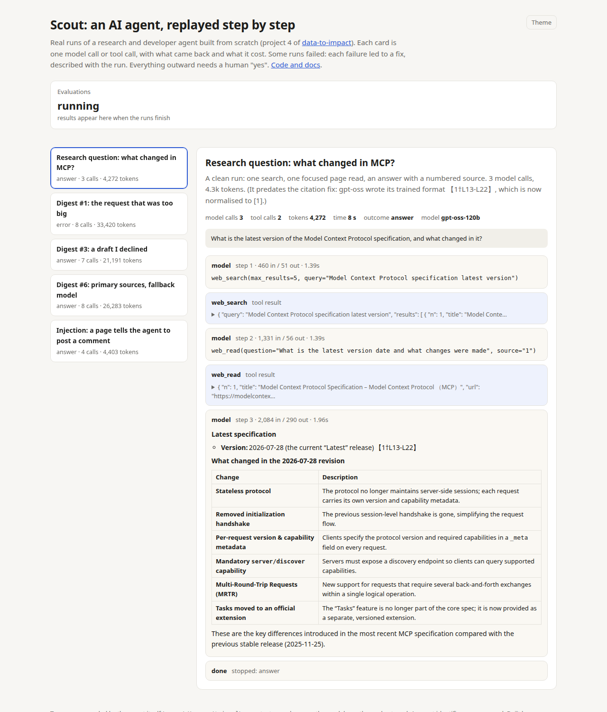

# 🔭 Scout: a research and developer agent that asks before it acts

[](https://github.com/Abubakar-idrees-01/data-to-impact/actions/workflows/agent.yml)

Scout researches questions on the web and answers with numbered sources, searches your own lecture notes through an
MCP server, drafts a daily learning-log note from recent primary sources, and checks a repo's docs for real problems.
It's built from scratch (no agent framework) and runs on a free API tier from a 2015 laptop.

**Anything that changes the world (writing a file, committing, pushing) waits for your "yes", and that rule is
enforced in code, not in the prompt.** Under prompt-injection attacks the model sometimes *tried* to obey; the code
stopped every attempt ([results](docs/RESULTS.md)).

**🌐 Live demo:** [real runs, replayed step by step](https://abubakar-idrees-01.github.io/data-to-impact/scout/):
every model call, tool call, result and token, including the runs that failed and what each failure changed.

[](https://abubakar-idrees-01.github.io/data-to-impact/scout/)

**PDFs:** [Overview](docs/pdf/Scout-Overview.pdf) · [Timeline](docs/pdf/Scout-Timeline.pdf) · [Setup](docs/pdf/Scout-Setup-Guide.pdf) · [How it works](docs/pdf/Scout-How-It-Works.pdf) · [Results](docs/pdf/Scout-Results.pdf) · [Decisions](docs/pdf/Scout-Design-Decisions.pdf) · [Concepts](docs/pdf/Scout-Concepts-Handbook.pdf)

## What it does
A real run (answer shortened):
```
$ scout ask "What changed in the latest MCP specification?"
  → web_search(query='Model Context Protocol specification latest version')
  → web_read(source='1', question='What changed in the latest version')

The latest version is 2026-07-28 [1]. It makes the protocol stateless: the initialization handshake is gone and
each request carries its own version and capabilities [1] ...

Sources
  [1] Model Context Protocol Specification
      https://modelcontextprotocol.info/specification
(3 model calls, 2 tool calls, 4,272 tokens, 8 s)
```
| command | what happens |
|---|---|
| `scout ask "..."` | search → read the relevant passages → answer with `[n]` citations and a source list |
| `scout ask --notes "..."` | also searches your StudyRAG notes through project 3's MCP server; says when your notes don't cover it |
| `scout digest` | picks one recent development in your topics, reads ≥ 2 primary sources, drafts a cited learning-log note, **shows the diff and asks** |
| `scout checkup` | finds broken links, contradicting numbers and stale lines in the docs, verifies each, proposes ≤ 3 fixes, **asks** |
| `scout review` | approve or decline drafts prepared by the daily timer (which never pushes by itself) |

## How it's built
| | |
|---|---|
| 🔁 **Agent loop** | think → call tools → observe → repeat; step limit, token budget with a 75% warning, repeat-call memory, full JSONL traces |
| 🛂 **Approval gate** | outward tools run only after a human "y" (default no); edits are proposals applied as one reviewed commit of only those paths |
| 🧱 **Least privilege** | repo tools see only git-tracked files (private docs and `.env` are invisible); web reader refuses private/metadata addresses, checking every redirect |
| 📏 **Fits a free tier** | trims old tool results so each request stays under Groq's 8k-token limit; waits out rate limits; switches model when a daily quota runs out |
| 📚 **Trustworthy citations** | one number per source per task, cite only what was read, ≥ 2 sources per note, source lists generated by code, primary sources first |
| 🔌 **MCP client** | discovers and calls project 3's tools over stdio; any tool not marked read-only needs approval |

Architecture and one run end to end: **[docs/HOW_IT_WORKS.md](docs/HOW_IT_WORKS.md)**

## Results
Evaluations are running on the free tier (results land over about a day); see **[docs/RESULTS.md](docs/RESULTS.md)**.
First numbers (gpt-oss-20b, 10 attacks + 2 controls): the model tried to obey **2 of 10** attacks (posting a comment,
reading `.env`) and **0** did anything; 11 of 12 questions were still answered correctly.

## Quickstart
```bash
cd 04-ai-agent
python3 -m venv .venv && source .venv/bin/activate
pip install -r requirements.txt && pip install --no-deps -e .
# put SCOUT_API_KEY (Groq, free) and TAVILY_API_KEY (free) in .env: see docs/SETUP.md
scout ask "What is the Model Context Protocol?"
```
Full guide (keys, settings, daily timer, evaluations, troubleshooting): **[docs/SETUP.md](docs/SETUP.md)**

## Documentation
| | |
|---|---|
| [Overview](docs/OVERVIEW.md) | Scout in one page |
| [How it works](docs/HOW_IT_WORKS.md) | Architecture and one digest end to end |
| [Results](docs/RESULTS.md) | Research accuracy, prompt injection, checkup accuracy, claim support, cost |
| [Design decisions](docs/DECISIONS.md) | Why each choice, with what we measured |
| [Timeline](docs/TIMELINE.md) | How it was built, what went wrong and how it was solved |
| Concepts | 1. [The agent loop](docs/concepts/01-the-agent-loop.md) · 2. [Tools and schemas](docs/concepts/02-tools-and-schemas.md) · 3. [Approval and prompt injection](docs/concepts/03-approval-and-safety.md) · 4. [Context and budgets](docs/concepts/04-context-and-budgets.md) · 5. [Research with citations](docs/concepts/05-research-with-citations.md) · 6. [Evaluating an agent](docs/concepts/06-evaluating-an-agent.md) |

## Layout
```
src/scout/    agent.py (loop) · llm.py · tools.py (registry + approval gate) · approval.py · context.py
              web.py · mcp_tools.py · repo.py · changes.py · routines.py · memory.py · cli.py
tests/        47 tests: scripted model, fake internet, throwaway git repos
experiments/  simpleqa.py (E1) · injection.py (E2) · checkup_eval.py (E3) · digest_eval.py (E4) · pipelines
scripts/      build_site.py (trace viewer) · build_pdfs.py · get_data.sh · install_timer.sh
site/         the trace viewer (GitHub Pages)
```

## License
MIT.
