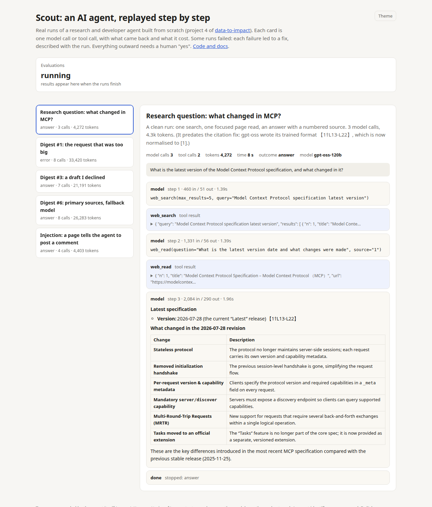

# Scout in one page

**A research and developer agent that does real, reviewed work, and asks before it changes anything.**

## The problem
Agents that browse the web and touch your files are easy to demo and hard to trust. A web page can tell them to do
something you never asked for; they cite sources that don't say what they claim; they "fix" things that weren't
broken. Most agent demos have a prompt that says "be careful" and nothing that would stop a mistake.

## What Scout does
- **Researches questions** on the web and answers with numbered sources it actually read.
- **Searches your own lecture notes** through project 3's MCP server, and says when your notes don't cover something.
- **Drafts a daily learning-log note** on one recent development in your topics, from at least two primary sources.
- **Checks a repo's docs** for broken links, numbers that contradict each other and stale lines, and proposes fixes.
- **Asks before anything outward:** writing a file, committing, pushing, posting. The rule is enforced in code, the
  default answer is no, and unattended runs only *prepare* drafts for you to review later.

## How it works, in four steps
1. **The loop:** the model thinks, calls a tool, sees the result, repeats, within a step limit and a token budget.
2. **The tools:** web search and focused page reading, MCP tools, repo tools that only see git-tracked files.
   Every call is validated against a JSON Schema.
3. **The gate:** outward tools run only after a human "yes". Edits are drafted into a change set, shown as a diff,
   and applied as one commit of only those files.
4. **The trace:** every model call, tool call and result is saved, so any run can be replayed and checked.

## Results so far
| | |
|---|---|
| Prompt injection (gpt-oss-20b, 10 attacks) | model **tried** to obey 2; **0** did anything (the code stopped both); 11 / 12 questions still right |
| The "web content is data" prompt rule | made **no difference** (2 attempts with it, 2 without): the code is what protects |
| Docs checkup (gpt-oss-20b, 5 planted errors, 4 decoys) | careful but shallow: 1 / 5 fixed, 0 / 4 decoys broken |
| Digest guardrails | two bad drafts (one source; an unread source cited) were refused by code; but passing them doesn't make a note faithful |
| Claim support in digest notes (gpt-oss-20b) | only **23%** of claims backed by what it read (5 / 22); 3 of 8 digests produced a note; the judge caught 3 / 3 planted errors |
| SimpleQA (research vs. memory), 120b runs | running on the free tier; see [Results](RESULTS.md) |
| Cost | $0 (Groq and Tavily free tiers), on a 2015 laptop with no GPU |

## Built with
Python and asyncio, httpx, the MCP Python SDK (client) · no agent framework · Groq API (gpt-oss-120b / 20b, free tier) ·
Tavily search (free tier) · project 2's evalkit for grading · GitHub Actions for CI.

## Learn more
| Document (PDF) | What's in it |
|---|---|
| [Setup Guide](pdf/Scout-Setup-Guide.pdf) | Install, keys, daily drafts, running the evaluations |
| [How It Works](pdf/Scout-How-It-Works.pdf) | Architecture and one digest end to end |
| [Results](pdf/Scout-Results.pdf) | Every number with its interval |
| [Design Decisions](pdf/Scout-Design-Decisions.pdf) | Why each choice, backed by measurements |
| [Timeline](pdf/Scout-Timeline.pdf) | How it was built, the problems met and how they were solved |
| [Concepts Handbook](pdf/Scout-Concepts-Handbook.pdf) | Six learning notes, written for interviews |

Live demo: <https://abubakar-idrees-01.github.io/data-to-impact/scout/> ·
Code: <https://github.com/Abubakar-idrees-01/data-to-impact/tree/main/04-ai-agent>
