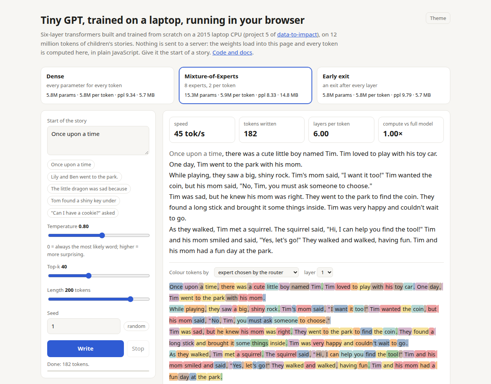

# ⚡ Adaptive LLM: a tiny GPT from scratch, and an engine that fits models to weak hardware

A chat assistant designed for weak, GPU-less machines, built in two parts:

- **A tiny GPT built from scratch** (tokenizer, transformer, training loop) with **Mixture-of-Experts** and
  **early-exit** layers, so only part of the model runs for each token, trained on a 2015 laptop CPU.
- **A hardware-adaptive inference engine** that profiles the machine, routes each prompt to the smallest model that
  can handle it, and uses quantization and speculative decoding for speed.

**Status:** ✅ both parts built and measured ([results](docs/RESULTS.md)), including the offline Scout demo.

## Try the tiny GPT in your browser
**🌐 Live demo:** [abubakar-idrees-01.github.io/data-to-impact/tinygpt](https://abubakar-idrees-01.github.io/data-to-impact/tinygpt/) (downloads 6–15 MB of weights, then runs offline in the tab)



[`site/`](site/) runs the trained models **entirely in the browser**, in plain JavaScript with no libraries and no
server. You get the tokenizer, attention with a KV cache, Mixture-of-Experts routing and early exits, checked against
PyTorch (logits within 4 × 10⁻⁷, identical greedy stories). Pick a model and give it the start of a story. Colour the
tokens by the expert the router chose, or turn on early exit and watch "layers per token" fall while "compute vs
full model" *rises* (the checks cost more than the layers they skip; concept 4). Weights are 8-bit, one scale per
row: 5.7 / 14.8 / 5.7 MB, at +0.0001–0.0004 validation loss.

```bash
PYTHONPATH=src .venv/bin/python -m tinygpt.export_web     # trained models -> site/models/ (int8) + tokenizer
python3 -m http.server 8000 -d site                        # open http://localhost:8000
```

## Why
Training a ChatGPT-quality model is impossible on a CPU. Part A builds a tiny model to *show* the ideas behind
efficient models and measure them honestly; Part B applies them to real open models people can actually use.

## Progress
| phase | what | status |
|---|---|---|
| A1 | TinyStories data + byte-level BPE tokenizer written from scratch | ✅ 4,096 tokens, 57.6M tokens of stories, 3.95 chars/token |
| A2 | dense GPT baseline, training loop, CPU throughput | ✅ 5.84M params, 12.3M tokens in 96 min, val loss 2.235 (ppl 9.3); 2 threads beat 4 |
| A3 | Mixture-of-Experts layers | ✅ at equal active compute: 8×top-2 ppl 8.33, 4×top-1 8.85, dense 9.34; 6–12% slower on CPU; top-1 gating bug found and fixed |
| A4 | early exit | ✅ layer-1 exit ppl 13.8 (untrained: 130); confidence checks cost more than the layers they skip, so a fixed exit at layer 4 (0.72× compute, ppl 10.1) is the better trade |
| B1 | hardware profiler (cores, SIMD flags, RAM, GPU, measured bandwidth), GGUF reader, model/quant planner | ✅ 21 GB/s; llama.cpp reaches 47–72% of the bandwidth ceiling (calibrated per architecture); planner now picks the fastest model not significantly less accurate than the best: Qwen2.5-1.5B |
| B2 | llama.cpp runtime (streaming, TTFT/decode timing, KV-cache reuse), model ladder with LRU unloading, benchmark + calibration | ✅ cached 2nd turn 13× faster to first token; loading without mmap saves 17–32% RAM (repacked weights were resident twice) |
| B3 | rule router (prompt features), confidence cascade (token probabilities via a llama.cpp logits hook), 128 auto-graded questions (capitals, arithmetic, GSM8K), offline policy simulation | ✅ no router or cascade beats always-1.5B on held-out questions; confidence AUROC 0.85–1.0 on short answers, 0.51–0.66 after chain-of-thought |
| B4 | greedy speculative decoding on llama.cpp's batch API (draft k tokens, verify in one pass); rollback by cache removal, or per-sequence state snapshots (19.5 MB) for Qwen3.5, whose recurrent layers cannot rewind | ✅ slower here in all 24 settings (×0.24–0.64): verifying 5 tokens costs 3.4–3.8 steps on 2 cores; measured cost model predicts it within 0.05 |
| B5 | headline policies on a held-out half (τ chosen on the other half) exported as evalkit runs for paired comparison | ✅ 7 policies as evalkit runs, McNemar comparisons in concept 6 |
| B5 | OpenAI-compatible server over the engine (each model's own chat template; Qwen2.5 JSON and Qwen3.5 XML tool calls parsed), so project 4's agent can run offline | ✅ Scout answered from the user's notes fully offline on Qwen2.5-1.5B (2 model calls, 1 tool call, 160 s) |

## Quickstart
```bash
cd 05-adaptive-llm
python3 -m venv .venv
.venv/bin/pip install -r requirements.txt                  # CPU-only torch, numpy, pytest
bash scripts/get_data.sh                                   # TinyStories: 22 MB valid + first 200 MB of train
PYTHONPATH=src .venv/bin/python -m tinygpt.data            # train the tokenizer, encode the stories (~1 min)
.venv/bin/python -m pytest -q
PYTHONPATH=src .venv/bin/python -m adaptive.plan           # what can this machine run? (Part B)
```
Full guide: [docs/SETUP.md](docs/SETUP.md)

## Documentation
| | |
|---|---|
| [Setup](docs/SETUP.md) | Install on Linux / Windows / macOS, data, troubleshooting |
| [How it works](docs/HOW_IT_WORKS.md) | Architecture of both parts, data flow of one request |
| [Results](docs/RESULTS.md) | Every measured number, both parts |
| [Decisions](docs/DECISIONS.md) | Why X over Y, with the measurements |
| [Timeline](docs/TIMELINE.md) | What happened, in order, including the mistakes |
| Concepts | 1. [Tokenization (BPE)](docs/concepts/01-tokenization-bpe.md) · 2. [The transformer and training](docs/concepts/02-the-transformer-and-training.md) · 3. [Mixture-of-Experts](docs/concepts/03-mixture-of-experts.md) · 4. [Early exit](docs/concepts/04-early-exit.md) · 5. [Hardware-aware model choice](docs/concepts/05-hardware-aware-model-choice.md) · 6. [Routing and cascades](docs/concepts/06-routing-and-cascades.md) · 7. [Speculative decoding](docs/concepts/07-speculative-decoding.md) |

## Data
[TinyStories](https://huggingface.co/datasets/roneneldan/TinyStories) (Eldan & Li, 2023), V2 stories written by
GPT-4, licence CDLA-Sharing-1.0. Downloaded by script, not stored in this repo.

## License
MIT.
